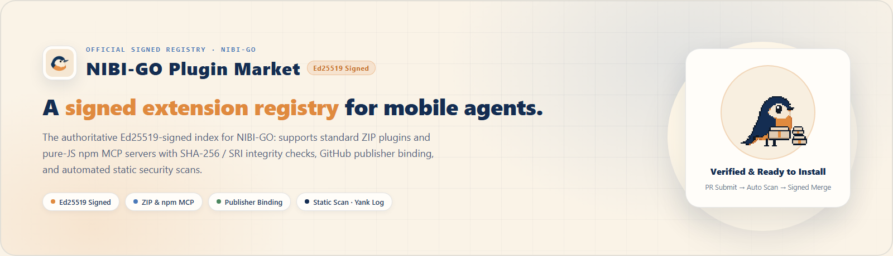
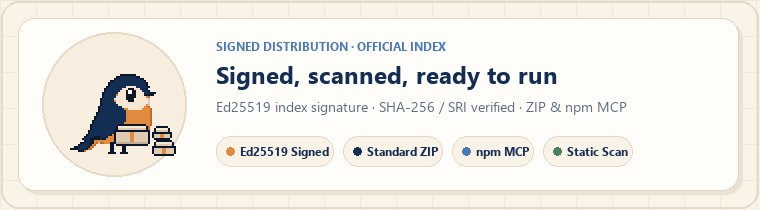
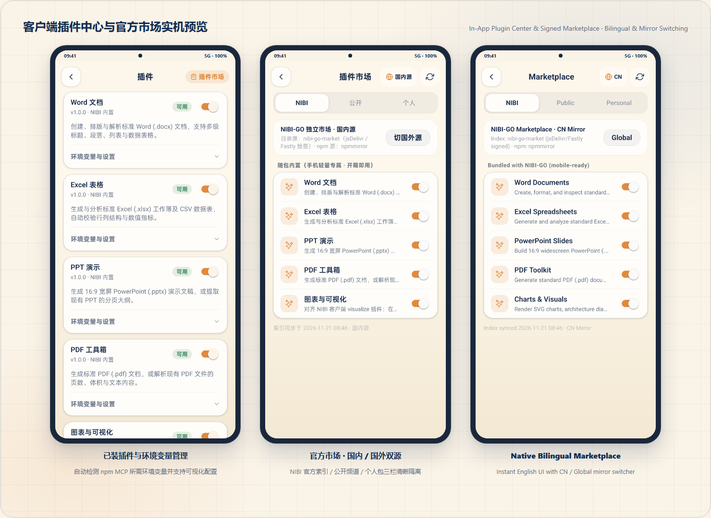

# NIBI-GO Plugin Market

<div align="center">
  

  <p>
    <a href="README.md">简体中文</a> ·
    <strong>English</strong> ·
    <a href="https://github.com/Ebonyhtx/nibi-go">NIBI-GO Client Source</a> ·
    <a href="CONTRIBUTING.md">Submit a Plugin</a> ·
    <a href="SECURITY.md">Security</a>
  </p>
</div>

This repository is the official signed plugin registry for **[NIBI-GO](https://github.com/Ebonyhtx/nibi-go)**. It hosts the **Ed25519-signed official index (`index.json` + `index.json.sig`)**, vetted plugin packages, and the **public revocation log (`yanked.json`)**, mirrored automatically to CDN with instant CN / Global source switching inside the mobile client.

<div align="center">
  
</div>

---

## In-App Preview

<div align="center">
  
</div>

---

## Supported Plugin Formats

| Format | Best for | Integrity Check | Client Experience |
|---|---|---|---|
| **Standard ZIP Plugin** (`format: "zip"`) | Full mobile plugins with root `nibi-go.plugin.json` (`mcp.v1` / `slots.v1` / `view.v1` / `effects.v1`) | `sha256` + byte size + manifest parity | One-tap download, digest check, extract, and register tools/actions/skills |
| **Pure-JS npm MCP Package** (`format: "npm"`) | Public npm MCP servers (pure JavaScript; no native `.node` binaries or `postinstall` hooks) | Exact `name@version` + npm SRI `integrity` | Native install from CN/Global mirror with automatic env-var detection and visual config UI |

---

## For Users: Verifiable Distribution

- **Ed25519 signatures & anti-rollback**: NIBI-GO only accepts officially signed indexes and enforces monotonically increasing `revision` numbers so older snapshots cannot downgrade newer ones.
- **End-to-end digest verification**: every ZIP archive is verified against `sha256`, and every npm MCP package is pinned to its exact SRI `integrity` hash; tampered or incomplete artifacts are rejected before installation.
- **Strict GitHub publisher binding**: once a plugin `id` is listed, it is bound to its `publisherGithub` account. Future updates must originate from the same GitHub publisher, preventing drive-by hijacking.
- **Transparent revocations**: compromised or policy-violating releases are removed from `index.json` and recorded publicly in `yanked.json`.

> **Security notice**: plugins are **executable code**. Installing a third-party plugin runs code written by its author on your device. Static scanning and human review reduce risk but do not guarantee safety — install only entries you trust. Report vulnerabilities privately via [SECURITY.md](SECURITY.md).

---

## For Authors: Submitting via Pull Request

Submit new plugins or updates by opening a pull request. **Never edit `index.json` or `index.json.sig` directly** — the signed index is updated automatically after review and merge.

1. **Standard ZIP plugin**: package a ZIP with a root `nibi-go.plugin.json` (in `packages/<id>-<version>.zip` or attached to your GitHub Release) and add `submissions/<id>-<version>.json` with metadata, `sha256`, and `size`.
2. **npm MCP plugin**: add `submissions/<id>-<version>.json` declaring `package.format = "npm"`, `name`, `version`, and SRI `integrity`.
3. **Automated CI gates**: every PR runs schema validation, digest verification, `publisher.github` / PR author / `source` ownership checks, static malware scanning (`scripts/scan-package.mjs`), and public-repo leak + image metadata checks (`scripts/check-leaks.mjs`).
4. **Human review & signed release**: maintainers review license, privacy disclosures, and least-privilege capabilities per [CONTRIBUTING.md](CONTRIBUTING.md); upon merge, the next `revision` is published and signed with Ed25519.

---

## Repository Layout & Gates

| Path | Responsibility |
|---|---|
| `index.json` / `index.json.sig` | Authoritative Ed25519-signed plugin index |
| `yanked.json` | Public append-only revocation ledger |
| `packages/` | Hosted vetted plugin archives (`.zip`) |
| `submissions/` | Pull-request submission descriptors (unsigned inputs) |
| `assets/` | Public Paper-Bird visual assets (EXIF-stripped, metadata-clean) |
| `scripts/validate.mjs` | Verifies Ed25519 signature, schema, ZIP/npm digests, and version monotonicity |
| `scripts/check-submissions.mjs` | Validates PR descriptors, GitHub publisher ownership, and manifest parity |
| `scripts/scan-package.mjs` | Static security scanner (blocks obfuscated `eval`, reverse shells, path traversal, `.node`/`postinstall`, etc.) |
| `scripts/check-leaks.mjs` | Strict file allowlist, secret/path leak scanner, and PNG/GIF metadata gate |
| `scripts/auto-publish.mjs` | Post-merge index publisher and signature generator |
| `.github/workflows/` | Automated PR validation and post-merge signing workflows |

### Run Gates Locally

```bash
node scripts/validate.mjs
node scripts/check-leaks.mjs
node --test scripts/scan-package.test.mjs
```

---

## License

Index metadata, verification scripts, and documentation in this repository are released under **[Apache License 2.0](LICENSE)**. Each third-party plugin package is governed by the `license` declared in its index entry.
