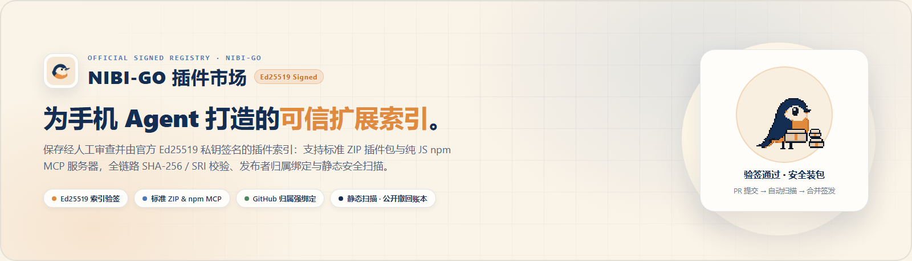
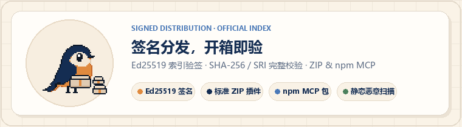
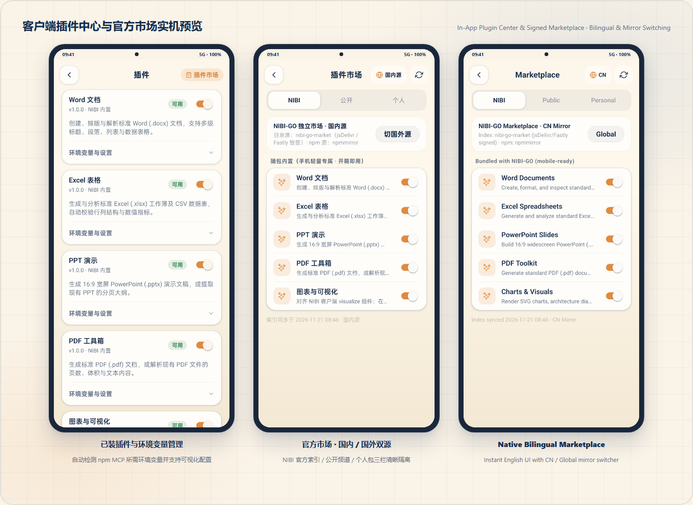

# NIBI-GO 插件市场

<div align="center">
  

  <p>
    <strong>简体中文</strong> ·
    <a href="README.en.md">English</a> ·
    <a href="https://github.com/Ebonyhtx/nibi-go">NIBI-GO 客户端源码</a> ·
    <a href="CONTRIBUTING.md">提交插件指南</a> ·
    <a href="SECURITY.md">安全报告</a>
  </p>
</div>

本仓库是 **[NIBI-GO](https://github.com/Ebonyhtx/nibi-go)** 的官方签名插件市场，保存**官方签名索引（`index.json` + `index.json.sig`）**、**标准插件包**与**公开撤回记录（`yanked.json`）**，是 NIBI-GO 客户端“插件市场”的权威来源，并自动镜像至分发 CDN（支持客户端国内源 / 国外源一键切换）。

<div align="center">
  
</div>

---

## 客户端实机预览

<div align="center">
  
</div>

---

## 支持的两种插件格式

| 格式 | 适用场景 | 完整性校验 | 客户端体验 |
|---|---|---|---|
| **标准 ZIP 插件** (`format: "zip"`) | 带 `nibi-go.plugin.json` 清单的完整移动插件（支持 `mcp.v1` / `slots.v1` / `view.v1` / `effects.v1`） | 强校验 `sha256` + 文件大小 + 清单一致性 | 一键下载、验签解压并注册工具/快捷动作/技能 |
| **纯 JS npm MCP 包** (`format: "npm"`) | 公开 npm registry 上的纯 JS MCP 服务器（无原生 `.node` / 禁 `postinstall`） | 强校验 `name@version` + npm `integrity`（SRI） | 客户端从国内/国外源原生安装，自动识别所需环境变量并提供可视化表单 |

---

## 对用户：安全与可验证分发

- **Ed25519 索引验签与防回滚**：客户端只接受官方私钥签名的索引，并按单调递增的 `revision` 校验，旧索引无法覆盖新索引。
- **全链路摘要校验**：每个 ZIP 包按 `sha256` 校验，每个 npm MCP 包按 SRI `integrity` 校验；被篡改或残缺的产物会被直接拒绝安装。
- **发布者归属强绑定**：每个插件 `id` 首次上架后即绑定至其 GitHub 发布者账号（`publisherGithub`），后续版本更新必须由同一发布者提交，防止恶意抢注或接管。
- **透明的撤回机制**：发现安全问题或违规条目时，维护者会将其从 `index.json` 移除并追加记录至公开的 `yanked.json`。

> **重要提示**：插件是**会运行的代码**。安装第三方插件等于在本机运行作者提供的程序。自动化静态扫描与人工审查能够显著降低风险，但不等于绝对安全保证；请只安装你信任的来源。发现安全问题请按 [SECURITY.md](SECURITY.md) 私下报告。

---

## 对插件作者：通过 PR 提交上架

提交新插件或新版本只需发起 Pull Request，**不要手动修改 `index.json` / `index.json.sig`**（由官方签名流程在审查合并后自动签发）：

1. **标准 ZIP 插件**：打包含根目录 `nibi-go.plugin.json` 的 ZIP（放入 `packages/<id>-<version>.zip` 或发布在本人 GitHub Release），并在 `submissions/<id>-<version>.json` 填写元数据与 `sha256` / `size`；
2. **npm MCP 插件**：在 `submissions/<id>-<version>.json` 中声明 `package.format = "npm"`、`name`、`version` 与 `integrity`（SRI）；
3. **开 PR 过自动门禁**：CI 会自动执行格式校验、包摘要核对、`publisher.github` 与 PR 作者及 `source` 仓库归属核验、恶意模式静态扫描（`scripts/scan-package.mjs`）以及仓库泄露门禁（`scripts/check-leaks.mjs`）；
4. **人工审查并签发**：维护者按 [CONTRIBUTING.md](CONTRIBUTING.md) 清单复核许可、隐私与最小权限面；合并后自动生成下一 `revision` 并由 Ed25519 密钥签发索引。

详细提交 schema、版本规则、静态扫描规则与审查清单见 [CONTRIBUTING.md](CONTRIBUTING.md)。

---

## 仓库结构与门禁

| 路径 | 职责 |
|---|---|
| `index.json` / `index.json.sig` | 官方 Ed25519 签名插件索引（客户端权威源） |
| `yanked.json` | 公开追加式撤回账本（id、版本、原因、时间、生效 revision） |
| `packages/` | 仓内托管的审查通过插件包（`.zip`） |
| `submissions/` | PR 提交元数据目录（未签名，仅作为审查与签发输入） |
| `assets/` | 市场仓库公开视觉展示素材（无 EXIF / 无私有元数据） |
| `scripts/validate.mjs` | 校验 Ed25519 签名、索引 schema、ZIP/npm 摘要与版本单调性 |
| `scripts/check-submissions.mjs` | 校验 PR 提交格式、GitHub 发布者归属绑定与包清单一致性 |
| `scripts/scan-package.mjs` | 静态安全扫描（拦截混淆 `eval`、反连 shell、越界路径、`.node`/`postinstall` 等高危模式） |
| `scripts/check-leaks.mjs` | 公开仓白名单、凭据/路径泄露与图片元数据脱敏门禁 |
| `scripts/auto-publish.mjs` | 维护者合并后的索引更新与自动签发脚本 |
| `.github/workflows/` | 每次 Push / PR 运行完整校验门禁，并在审核合并后签发索引 |

### 本地运行校验

```bash
node scripts/validate.mjs
node scripts/check-leaks.mjs
node --test scripts/scan-package.test.mjs
```

---

## 许可证

本仓库的索引元数据、门禁脚本与文档以 **[Apache License 2.0](LICENSE)** 发布；每个第三方插件包的许可证以各自条目中声明的 `license` 为准。
